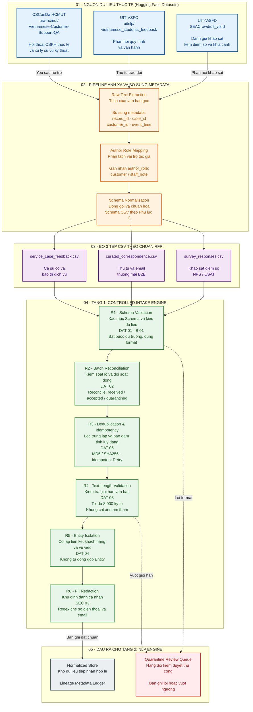

# Tầng 1: Phân hệ Tiếp nhận Dữ liệu có Kiểm soát (Controlled Intake)

Tài liệu thiết kế và đặc tả kỹ thuật chi tiết cho Tầng 1 căn cứ theo Điều khoản DAT 01 - DAT 08 (Trang 5), Hợp đồng B 01 (Trang 20) và Phụ lục C (Trang 21) của tài liệu [SongNhat_Vietnam_Voice_of_Customer_Insight_Engine_RFP.md](file:///c:/Users/ACER/__SongNhat/Voice%20of%20Customer%20Insight%20Engine/SongNhat_Vietnam_Voice_of_Customer_Insight_Engine_RFP.md).

---

## 1. Sơ đồ Phạm vi Tiếp nhận và Ánh xạ Dữ liệu (Mermaid Diagram)

---

## 2. Bảng Ánh xạ Chi tiết từ Hugging Face sang 3 Schema CSV

| Nguồn Hugging Face | Tệp CSV đích | Trường trích xuất gốc | Metadata bổ sung theo Phụ lục C |
| :--- | :--- | :--- | :--- |
| `ura-hcmut/Vietnamese-Customer-Support-QA` (CSConDa) | `service_case_feedback.csv` | Lượt hỏi/yêu cầu hỗ trợ kỹ thuật -> cột `text` | `record_id`: Chuỗi định danh bất biến `case_id`: Mã sự cố (CASE_xxxx) `customer_id`: Mã định danh doanh nghiệp `channel`: ticket/service_sheet `event_time`: Timestamp ISO 8601 `author_role`: customer hoặc staff_note `product_id`: Mã thiết bị/phụ tùng |
| `uitnlp/vietnamese_students_feedback` (UIT-VSFC) | `curated_correspondence.csv` | Đoạn văn nhận xét phản hồi -> cột `text` | `record_id`: Chuỗi định danh bất biến `case_id`: Mã hợp đồng/báo giá `customer_id`: Mã định danh doanh nghiệp `channel`: email `event_time`: Timestamp ISO 8601 `author_role`: customer `subject`: Tiêu đề thư B2B |
| `SEACrowd/uit_visfd` (UIT-ViSFD) | `survey_responses.csv` | Câu đánh giá khảo sát -> cột `text` Nhãn cảm xúc / điểm số -> cột `rating` (0-10) | `record_id`: Chuỗi định danh bất biến `customer_id`: Mã định danh doanh nghiệp `channel`: survey `event_time`: Timestamp ISO 8601 `rating`: Điểm số nguyên |

---

## 3. Định nghĩa Cấu trúc 3 Schema CSV Chuẩn (Data Contracts)

### 3.1. `service_case_feedback.csv` (Sự cố và dịch vụ kỹ thuật)
* `record_id` (String, PK): Định danh bất biến của bản ghi tiếp nhận.
* `case_id` (String): Mã vụ việc kỹ thuật / phiếu hỗ trợ.
* `customer_id` (String): Mã khách hàng doanh nghiệp.
* `channel` (String): Kênh tiếp nhận (`ticket`, `service_sheet`, `portal`).
* `event_time` (ISO 8601): Thời điểm phát sinh sự kiện phản hồi.
* `author_role` (String): Vai trò người viết (`customer` hoặc `staff_note`).
* `text` (String): Nội dung văn bản phản hồi.
* `product_id` (String): Mã thiết bị / động cơ liên quan.

### 3.2. `curated_correspondence.csv` (Thư từ email thương mại B2B)
* `record_id` (String, PK): Định danh duy nhất.
* `case_id` (String): Mã vụ việc hoặc mã báo giá/hợp đồng.
* `customer_id` (String): Mã khách hàng doanh nghiệp.
* `channel` (String): Cố định giá trị `email`.
* `event_time` (ISO 8601): Thời điểm gửi/nhận email.
* `author_role` (String): `customer` hoặc `staff_note`.
* `text` (String): Nội dung đoạn trao đổi đã lọc trích dẫn cũ.
* `subject` (String): Tiêu đề thư hoặc chủ đề giao dịch.

### 3.3. `survey_responses.csv` (Khảo sát điểm số)
* `record_id` (String, PK): Định danh duy nhất.
* `customer_id` (String): Mã khách hàng doanh nghiệp.
* `channel` (String): Cố định giá trị `survey`.
* `event_time` (ISO 8601): Thời điểm khách hàng hoàn tất khảo sát.
* `rating` (Integer, Nullable): Điểm số đánh giá (0-10 cho NPS, 1-5 cho CSAT).
* `text` (String, Nullable): Bình luận hoặc ý kiến đóng góp đi kèm.

---

## 4. Các Quy tắc Xử lý Nghiệp vụ Bắt buộc (DAT 01 - DAT 08, SEC 03)

* **DAT 01 (Bảo lưu nguồn gốc - Lineage):** Lưu giữ `record_id`, thời điểm nhập liệu (`import_time`), phiên bản bản ghi. Phân tách dứt khoát giữa `customer` và `staff_note`; nghiêm cấm coi ghi chú của nhân viên là trích dẫn trực tiếp của khách hàng.
* **DAT 02 (Kiểm soát lô - Batch controls):** Đối soát số lượng dòng tiếp nhận, hợp lệ và cách ly (quarantine). Quá trình nạp lại phải có tính lũy đẳng (idempotent), không để tệp cũ đè tệp mới.
* **DAT 03 (Giới hạn văn bản - Text limits):** Giới hạn tối đa 8.000 ký tự phân tích trên một bản ghi. Bản ghi vượt giới hạn hoặc lỗi mã hóa chuyển vào hàng đợi kiểm duyệt thủ công (review queue), nghiêm cấm cắt xén âm thầm (no silent truncation).
* **DAT 04 (Liên kết khách hàng và vụ việc):** Không tự động gộp (auto-merge) khách hàng hoặc vụ việc nếu thiếu khóa liên kết xác thực.
* **DAT 05 (Khử trùng lặp - Duplicate treatment):** Tự động phát hiện và loại bỏ các bản ghi trùng lặp hoàn toàn khi nạp lại.
* **SEC 03 (Khử định danh PII):** Ẩn hoặc mã hóa số điện thoại, email cá nhân và tên riêng trước khi chuyển dữ liệu sang Tầng 2.

---

## 5. Kiến trúc Module Xử lý Intake (Python Implementation)

Module tiếp nhận bao gồm 5 thành phần xử lý tuần tự:
1. `SchemaValidator`: Kiểm tra kiểu dữ liệu, các trường bắt buộc và định dạng ngày tháng ISO 8601.
2. `DeduplicationHandler`: Tạo chuỗi băm SHA-256 trên nội dung để phát hiện và ngăn chặn bản ghi trùng lặp.
3. `TextLimitEnforcer`: Kiểm đếm số ký tự Unicode, định tuyến các bản ghi quá 8.000 ký tự vào hàng đợi cách ly.
4. `PIIRedactor`: Dùng biểu thức chính quy (Regex) để che số điện thoại, email cá nhân.
5. `ManifestLogger`: Ghi nhận nhật ký tiếp nhận (Batch Manifest) để đối soát dòng dữ liệu chấp thuận và cách ly.
