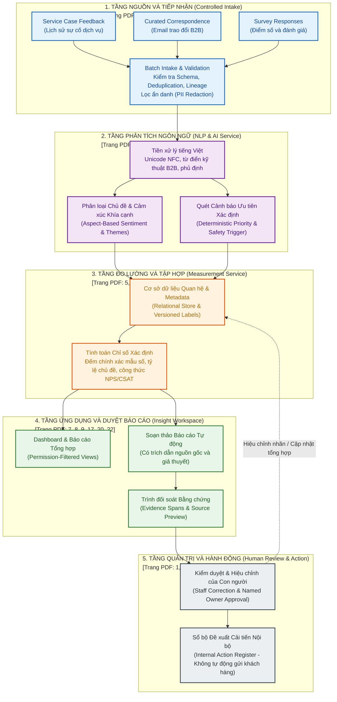

# Kiến trúc Tổng quan Hệ thống (High-Level Architecture)

Tài liệu này mô tả kiến trúc tổng thể cấp cao (high-level) của hệ thống **Voice of Customer Insight Engine** và ánh xạ chi tiết từng thành phần tới số trang cụ thể trong tệp tài liệu gốc [SongNhat_Vietnam_Voice_of_Customer_Insight_Engine_RFP.pdf](file:///c:/Users/ACER/__SongNhat/Voice%20of%20Customer%20Insight%20Engine/SongNhat_Vietnam_Voice_of_Customer_Insight_Engine_RFP.pdf) (tham chiếu bản Markdown tại [SongNhat_Vietnam_Voice_of_Customer_Insight_Engine_RFP.md](file:///c:/Users/ACER/__SongNhat/Voice%20of%20Customer%20Insight%20Engine/SongNhat_Vietnam_Voice_of_Customer_Insight_Engine_RFP.md)).

---

## 1. Sơ đồ Kiến trúc Cấp cao (High-Level Mermaid Diagram)

---

## 2. Đặc tả các Tầng Kiến trúc Cấp cao và Ánh xạ Điều khoản

### 2.1. Tầng Nguồn và Tiếp nhận (Controlled Intake)
* **Vị trí trong tài liệu PDF:** **Trang 3, 4, 5, 8, 20, 21**.
* **Điều khoản chi phối:** Package A (Trang 3), Bảng Parameter Sources (Trang 4), Điều khoản DAT 01 - DAT 08 (Trang 5), Work Package M Source intake (Trang 8), Hợp đồng B 01 (Trang 20), Phụ lục C Identity & Text evidence (Trang 21).
* **Nội dung kỹ thuật:**
  * Tiếp nhận 3 tệp dữ liệu chuẩn UTF-8 CSV: `service_case_feedback`, `curated_correspondence`, `survey_responses`.
  * Xử lý kiểm tra tính toàn vẹn (Batch reconciliation), chống trùng lặp (deduplication) và bảo lưu nguồn gốc (lineage - DAT 01, DAT 02).
  * Loại bỏ hoặc che dấu thông tin định danh cá nhân (PII redaction) trước khi chuyển vào tầng phân tích (SEC 03, Trang 9).

### 2.2. Tầng Phân tích Ngôn ngữ (NLP & AI Service)
* **Vị trí trong tài liệu PDF:** **Trang 3, 6, 8, 17, 20, 28**.
* **Điều khoản chi phối:** Package B (Trang 3), Vietnam suitability (Trang 3), Điều khoản ANL 01 - ANL 05 (Trang 6), Work Package M Analysis service (Trang 8), Annex A Figure 1 (Trang 17), Hợp đồng B 02 (Trang 20), Ràng buộc VN 01 (Trang 28).
* **Nội dung kỹ thuật:**
  * Xử lý ngôn ngữ tiếng Việt chuyên ngành công nghiệp B2B: xử lý Unicode dựng sẵn, từ ghép kỹ thuật, từ phủ định, từ viết tắt và không dấu.
  * Phân loại đa chủ đề (tối đa 12 chủ đề) và cảm xúc theo từng khía cạnh (Positive, Negative, Neutral, Mixed).
  * Quét từ khóa kích hoạt cảnh báo an toàn xác định (deterministic rules) cho các sự cố thiết bị nghiêm trọng (ANL 05, AT 03).

### 2.3. Tầng Đo lường và Tập hợp (Measurement Service)
* **Vị trí trong tài liệu PDF:** **Trang 5, 6, 7, 8, 18, 21**.
* **Điều khoản chi phối:** DAT 06 Units & denominators (Trang 5), ANL 06 - ANL 07 (Trang 6), INS 04 Numerical integrity (Trang 7), Work Package M Measurement service (Trang 8), Annex A Figure 2 (Trang 18), Hợp đồng B 03 (Trang 20), Phụ lục C Counting population & NPS formula (Trang 21).
* **Nội dung kỹ thuật:**
  * Áp dụng nguyên tắc đo lường xác định (deterministic queries): Nghiêm cấm mô hình AI tự suy đoán số liệu, tổng số hoặc tỷ lệ phần trăm (INS 04).
  * Quản lý mẫu số chính xác, theo dõi cohort theo vụ việc (`case_id`) và khách hàng (`customer_id`).
  * Tính điểm NPS/CSAT theo đúng công thức chuẩn được phê duyệt khi có trường khảo sát thực tế (Phụ lục C, Trang 21).

### 2.4. Tầng Ứng dụng và Duyệt Báo cáo (Insight Workspace)
* **Vị trí trong tài liệu PDF:** **Trang 3, 7, 8, 9, 17, 20, 22**.
* **Điều khoản chi phối:** Package C (Trang 3), Điều khoản INS 01 - INS 03 (Trang 7), Work Package M Insight workspace (Trang 8), SEC 01 - SEC 04 (Trang 9), Annex A Figure 1 (Trang 17), Hợp đồng B 04 - B 05 (Trang 20), NFR 03 - NFR 04 (Trang 22).
* **Nội dung kỹ thuật:**
  * Cung cấp giao diện tra cứu phân quyền (RBAC) theo tài khoản và cấp độ truy cập (SEC 01, SEC 04).
  * Cho phép xem lại trích đoạn gốc (evidence spans) tương ứng với từng nhận định phân tích (INS 02).
  * Hỗ trợ sinh bản nháp báo cáo tổng quan định kỳ có dẫn nguồn đối soát (INS 01).

### 2.5. Tầng Quản trị và Hành động (Human Review & Action)
* **Vị trí trong tài liệu PDF:** **Trang 1, 7, 9, 10, 11, 13, 19**.
* **Điều khoản chi phối:** Giới hạn phạm vi cốt lõi (Trang 1), INS 05 - INS 08 (Trang 7), SEC 05 - SEC 08 (Trang 9), AT 05, AT 08 (Trang 10), Release Gates G0 - G4 (Trang 11), Team roles (Trang 13), Annex A Figure 3 (Trang 19).
* **Nội dung kỹ thuật:**
  * Nhân sự phụ trách (Staff / Named Owner) duyệt, điều chỉnh nhãn sai lệch và ký duyệt báo cáo trước khi phát hành nội bộ (INS 05, INS 08).
  * Ghi nhận đề xuất cải tiến vào sổ bộ nội bộ (Action Register - INS 06, INS 07).
  * Tuân thủ quy định RFP: Tuyệt đối không tự động gửi thông tin cho khách hàng, không tự động ghi dữ liệu vào CRM, không chấm điểm nhân viên (Trang 1, Trang 6, Trang 9).

---

## 3. Các Nguyên tắc Vận hành Cốt lõi và Căn cứ Quy định

* **Tính phân định nguồn gốc:** Dữ liệu phản hồi của khách hàng và ghi chú của nhân viên phải được tách biệt hoàn toàn; không coi ghi chú nhân viên là trích dẫn trực tiếp từ khách hàng (DAT 01, Trang 5; Annex A Figure 1, Trang 17).
* **Tính toàn vẹn số liệu:** Mọi con số báo cáo phải tái lập được bằng truy vấn cơ sở dữ liệu xác định, không dùng LLM để tính nhẩm (INS 04, Trang 7; Annex A Figure 2, Trang 18).
* **Quyền kiểm soát con người:** Mọi phân loại ưu tiên, cáo buộc trách nhiệm hoặc hành động khắc phục đều phải có sự xác nhận của nhân sự quản lý trước khi áp dụng (ANL 04, Trang 6; INS 05, Trang 7; Annex A Figure 3, Trang 19).

---

## 4. Bảng Tra cứu Ánh xạ Từng Trang PDF sang Kiến trúc và Điều khoản

Bảng dưới đây liệt kê chi tiết toàn bộ 28 trang của tệp [SongNhat_Vietnam_Voice_of_Customer_Insight_Engine_RFP.pdf](file:///c:/Users/ACER/__SongNhat/Voice%20of%20Customer%20Insight%20Engine/SongNhat_Vietnam_Voice_of_Customer_Insight_Engine_RFP.pdf):

| Trang PDF | Tiêu đề nội dung trong PDF | Thành phần kiến trúc / Nghiệp vụ tương ứng | Các điều khoản và mã quy định chính |
| :---: | :--- | :--- | :--- |
| **1** | Request for Proposal & Giới thiệu | Phạm vi tổng quan, ranh giới loại trừ hệ thống | Loại trừ CRM writeback, equipment advice, scoring |
| **2** | Document navigation & Quy tắc ưu tiên | Khung định nghĩa và thứ bậc tài liệu | Quy ước nhãn M (bắt buộc) / O (tùy chọn) |
| **3** | 1 Objectives and Vietnam context | Tầng 1 (Nguồn), Tầng 2 (NLP) & Yêu cầu tiếng Việt | Package A, B, C, D, Options; Phù hợp Unicode |
| **4** | 2 Pilot limits and discovery readiness | Giới hạn dung lượng thử nghiệm, mốc G0 | Giới hạn 10.000 items, 3 schema CSV UTF-8 |
| **5** | 3 Controlled intake & measurement | Tầng 1 (Intake) và Tầng 3 (Đo lường xác định) | DAT 01 Lineage đến DAT 08 Corrections |
| **6** | 4 Feedback classification | Tầng 2 (NLP, Phân loại chủ đề, Cảm xúc) | ANL 01 Baseline đến ANL 08 Limits |
| **7** | 5 Source cited insights & action review | Tầng 4 (Workspace) và Tầng 5 (Human Review) | INS 01 Report đến INS 08 Corrections |
| **8** | 6 Architecture & work packages | Toàn bộ 5 tầng kiến trúc kỹ thuật của hệ thống | Work packages: Intake, Analysis, Measure, Ops |
| **9** | 7 Security privacy and governance | Tầng Quản trị bảo mật, phân quyền và PII | SEC 01 Current access đến SEC 08 Applicability |
| **10** | 8 Independent acceptance evaluation | Bộ tiêu chuẩn nghiệm thu kỹ thuật độc lập | AT 01 Theme F1 >= 0.85; AT 02 Aspect F1 >= 0.80 |
| **11** | 9 Release gates and acceptance | Quy trình đóng mở cổng nghiệm thu G0 đến G4 | G0 (Discovery), G1 (Week 2) đến G4 (Week 12) |
| **12** | 10 Delivery timeline & weekly plan | Kế hoạch triển khai theo tuần (12 tuần) | 6 chu kỳ Sprint 2 tuần sau mốc G0 |
| **13** | 11 Team ownership & collaboration | Cơ cấu nhân sự Bên mua và Nhà cung cấp | Phân bổ 3 FTEs (1.440 giờ làm việc) |
| **14** | 12 Deliverables pricing and support | Danh mục bàn giao và điều khoản SLA hỗ trợ | DEL 01 Discovery đến DEL 06 Exit; SLA P1, P2 |
| **15** | 13 Bidder response and evaluation | Thang điểm chấm thầu và cổng loại trừ | Thang điểm 100; Cổng loại trừ bắt buộc (Pass gates) |
| **16** | 14 Decisions required before award | Các quyết định Bên mua cần chốt trước khi trao thầu | Ranh giới phạm vi, quyền truy cập, chủ sở hữu |
| **17** | Annex A Figure 1 Feedback architecture | Sơ đồ luồng xử lý dữ liệu và kiểm soát riêng tư | Minh họa quy trình từ Input đến Action |
| **18** | Annex A Figure 2 Counting & interpretation | Sơ đồ nguyên tắc đếm và tính mẫu số xác định | Phân định cohort, trùng lặp, đa chủ đề |
| **19** | Annex A Figure 3 Review & action lifecycle | Sơ đồ vòng đời phê duyệt và hiệu chỉnh của con người | Quy trình kiểm duyệt báo cáo và ghi nhận hành động |
| **20** | Annex B Feature contracts & examples | Hợp đồng giao tiếp giữa các module (B 01 - B 06) | Contract I/O module và Ví dụ thực tế A, B, C, D |
| **21** | Annex C Data coverage & measurement | Hợp đồng dữ liệu, metadata và công thức NPS/CSAT | Đặc tả các trường bảng dữ liệu và công thức chuẩn |
| **22** | Annex D Workload & service tests | Bộ kiểm thử tải và kiểm thử phi chức năng | NFR 01 (10k items <= 12h) đến NFR 08 (Failure/Exit) |
| **23** | Annex E Economics & investment | Mô hình tài chính, tính toán thời gian hoàn vốn | Công thức tính ROI, Payback (25.3 - 31.2 tháng) |
| **24** | Annex E Cost realism & evidence | Bằng chứng đánh giá tính thực tế của chi phí | Yêu cầu đối chiếu với giải pháp native/có sẵn |
| **25** | Annex F Official sources register | Danh mục văn bản pháp lý Việt Nam áp dụng | R01 (Web) đến R05 (An ninh mạng, AI, Dữ liệu cá nhân) |
| **26** | Annex F Market evidence & limits | Khảo sát thị trường AI và giới hạn áp dụng | R07 (AWS AI 2026), R08 (FPT AI), R09 (HPT AI) |
| **27** | Annex G Current relevance & priorities | Thứ tự ưu tiên triển khai và khuyến nghị mua sắm | Đánh giá tính khả thi trong bối cảnh công nghiệp B2B |
| **28** | Annex G Vietnam readiness & feasibility | Quyết định khả thi và 7 yêu cầu đặc thù Việt Nam | VN 01 (Ngôn ngữ) đến VN 07 (Hiệu quả đầu tư) |
