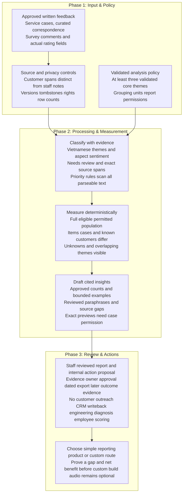
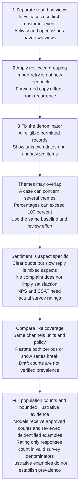
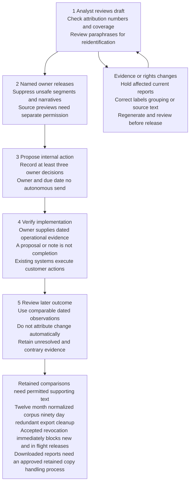

# Request for Proposal
**SongNhat**  
[songnhat.com.vn](https://songnhat.com.vn/)

## Voice of Customer Insight Engine
**Evidence based customer feedback analysis for Vietnam industrial sales and service**

SongNhat, hereafter the Purchaser and organizer, invites qualified suppliers to implement a Voice of Customer Insight Engine. The engine shall organize approved written customer feedback, identify themes and aspect level sentiment, and prepare source cited insight reports for internal sales and service improvement. Staff shall review important classifications, allegations and suggested actions before use.

The proposed business context is industrial products and services, consistent with the Purchaser website. The site does not establish actual feedback channels, systems, record volumes, customer satisfaction or complaint rates. These remain discovery assumptions. [R01]

Voice of Customer means customer feedback in this RFP. The core accepts controlled text exports, not live call recordings. A bounded pilot is feasible with usable source text, stable keys, permitted processing and available reviewers. Business value depends on recurring analysis effort, source coverage and actual supplier prices; no revenue uplift or complaint reduction is assumed.

Start with three agreed export schemas, Vietnamese analysis, deterministic counts, traceable themes and human review. Exclude autonomous customer communication, CRM writeback, root cause determination, technical equipment advice and employee scoring. Evaluate simple reporting, a configured product and custom delivery before selecting the route. No workflow engine, model provider or cloud brand is mandated.

---

## Document navigation

| Part | Contents |
| :--- | :--- |
| 1 to 2 | Objectives, Vietnam suitability, pilot limits and readiness |
| 3 to 5 | Source intake, feedback analysis and reviewed insights |
| 6 to 9 | Architecture, security, independent acceptance and release gates |
| 10 to 14 | Delivery, ownership, commercial response and issue decisions |
| Annex A | Three figures for architecture, counting and review |
| Annexes B to D | Feature contracts, data rules and operational tests |
| Annexes E to G | Economics, official references, current market relevance and Vietnam decision |

### Requirement and priority rules
M means mandatory core work and O a separately priced option. Shall and must denote requirements when awarded. Volumes, targets and schedules are proposed common bid assumptions until confirmed at issue. The executed agreement and amendments prevail over the issued RFP and addenda, then the accepted proposal. Trace each requirement ID to design, dependencies, cost, test and acceptance evidence.

### Operating definitions
* A **feedback item** is one source record with exact text and provenance.
* A **case** is an approved issue or interaction grouping; a customer may have several cases.
* A **theme** is a controlled topic, not a proven cause.
* **Sentiment** is a label for an expressed attitude toward a stated aspect; it is not overall satisfaction or customer intent.
* A **cited allegation** records what a customer reported and is not confirmation that the event occurred.

---

## 1 Objectives and Vietnam business context

Reduce repeated reading, tagging and consolidation of written feedback while making recurring issues and evidence gaps visible. Staff shall be able to inspect the original wording, correct labels and assign a proposed internal improvement action. The engine supports analysis of supplied feedback, not a representative survey of all customers.

| Package | Mandatory core scope |
| :--- | :--- |
| A Controlled feedback | Support service case text, curated correspondence and survey response schemas with stable keys and permissions. Agree active feeds at G0; an absent survey is declared outside coverage. |
| B Analysis | Vietnamese theme classification, aspect sentiment, language and scope checks, exact or reviewed duplicate grouping and priority review flags. |
| C Insight workspace | Permission filtered search, deterministic dashboards, source evidence, corrections, dated reports and reviewed internal action proposals. |
| D Operations | Daily batch processing, audit, versioning, access, retention, recovery and portable exit. |
| Options | Audio transcription, live connectors, extra languages, new taxonomies, additional sources and writeback, separately scoped and priced. |

### Vietnam suitability
Support Vietnamese Unicode, missing diacritics, negation, shorthand, mixed Vietnamese and English technical terms, and exact product identifiers. Distinguish a complaint about response speed from dissatisfaction with a motor or service outcome. Preserve quotations in the source language; any translation is labeled and remains linked to the original passage.

Start with themes approved by sales and service owners, such as response time, delivery communication, quotation clarity, product documentation, service coordination and reported product concerns. These are proposed categories, not assertions about SongNhat performance. Separate reported safety or equipment issues from engineering diagnosis and warranty entitlement. As of 5 November 2026, AI assisted feedback analytics is a timely applied topic with existing local offerings; its commercial priority for SongNhat remains unproven. [R07 to R09]

Curated text exports are a practical first step where channels are fragmented. Do not assume access to CRM, ERP, personal mailboxes, Zalo, social networks or manufacturer portals. A staff member possessing a message does not establish permission for every analysis or disclosure purpose. Confirm rights and applicable Vietnam duties before real data use. [R02 to R05]

---

## 2 Pilot limits and discovery readiness

| Parameter | Common bid basis |
| :--- | :--- |
| Organization | One SongNhat company and sales and service team; 15 named users, five concurrent sessions and up to three roles. |
| Sources | Three UTF 8 CSV schemas: service case feedback; curated correspondence; survey responses with comments and optional actual rating fields. No attachments, OCR or audio in core. |
| Corpus | Up to 50,000 retained items across twelve months and older open cases; initial analysis of up to 10,000 items. Maximum 8,000 Unicode characters of analyzable text per item. Retention and capacity shall fit recurring intake. |
| Refresh and usage | One daily batch per source; up to 1,000 new or changed items daily and 3,000 analyzed new or changed items monthly for pricing. Itemize initial corpus processing within the total initial price. |
| Taxonomy | Up to twelve approved themes, up to five themes per item, four aspect sentiment labels and a needs review state. Freeze at least three mandatory themes for validation at G1; insufficient real examples require explicit scope revision. Other unsupported themes remain manual. No model generated new production labels without approval. |
| Reports | Up to four saved report definitions, weekly or monthly runs and up to 100 generated reports monthly; Vietnamese output, normally two to four pages plus evidence appendix. |
| Output limits | Per item at most two processing passes, each at most 4,000 input and 600 output tokens including instructions and retries within those two passes. Per report at most 24,000 input and 3,500 output tokens, excluding a deterministic evidence appendix. |
| Schedule | Up to two weeks capped discovery, then twelve weeks core delivery after G0 readiness. Twenty business days supervised observation in weeks 7 to 10. |

### Readiness and G0 decision
Provide authorized representative exports, extraction dates, source keys, expected counts, source owners, access labels, example feedback and independent reviewers. Identify who will use the dashboard and who owns each improvement decision. Confirm whether enough real feedback and analysis effort exist to justify the work. Profile four representative historical weeks of records and time current tasks during discovery, allowing for seasonality. If history is missing, narrow the decision or agree a longer observation period. Compare a manual coded sample, current reporting and a configured product; no minimum volume is presumed.

G0 chooses proceed, narrow or stop before core commitment. The supplier shall profile text quality, historical coverage, duplicate forwarding, case and customer links, rare priority cases, privacy and manual preparation burden. If stable keys, permission or evaluation examples are unavailable, keep discovery bounded. A public website does not establish internal readiness.

---

## 3 Controlled intake and measurement units

| ID | Mandatory requirement |
| :--- | :--- |
| DAT 01 Lineage | Retain source key, batch and record version, text, event date, extraction and import times, channel, author role, audience and passage anchor. Analyze attributed customer spans separately from staff observations; unknown speaker stays unknown. Staff notes are not direct customer quotations. |
| DAT 02 Batch controls | Reconcile expected, received, accepted and quarantined rows. Retries are idempotent; late files cannot overwrite newer versions. Bind each run to exact source versions and cutoffs. Missing required or incomplete feeds remain visible and cannot support a complete coverage claim. Declare full snapshot or increment and explicit deletion tombstones. An absent row alone is not deletion. An absent survey declared at G0 shows unavailable coverage. |
| DAT 03 Text limits | Never truncate silently. Oversized, unreadable or unsupported records enter a visible review queue and are counted as unanalyzed. Strip approved quoted history only through a versioned rule preserving the original. Excluded text and reasons remain auditable. If the per pass token limit is exceeded, hold model analysis and retain the deterministic priority scan on parseable text. |
| DAT 04 Customer and case links | Use supplied approved customer and case keys; unknown links remain unknown. No automatic person or company merging. Keep branch, site, channel and product context separate; a shared contact does not join unrelated cases. |
| DAT 05 Duplicate treatment | Suppress identical import retries automatically. Forwarded or repeated content may suggest a group but needs approved grouping rules or staff review. A new recurrence is a separate case unless evidence supports the same issue. Preserve members and reversal. |
| DAT 06 Units and denominators | Show item, case and known customer counts separately. Use new case cohorts dated by first known customer event, plus separate dated item activity and open issue views. No reliable grouping means item counts only. Multi label theme percentages may exceed 100 percent; label the denominator and unknowns. |
| DAT 07 Freshness and periods | Separate event, extraction and import dates and source coverage. Target daily imports; stale means extraction older than two business days unless approved otherwise. Unknown dates are excluded from period trends with counts, not assigned the import date. |
| DAT 08 Corrections | Source edits, grouping changes, rights changes or deletions invalidate affected current aggregates and reports. Regenerate or hold them; retain dated versions under current rights. No silent rewrite of previously approved reports. |

A case may contain conflicting or changing sentiment over time. Preserve item level history and let approved reporting rules determine the dated case summary. Repeated messages from one customer are not votes from different customers. Counts use all eligible permitted records, independently of the limited text context supplied to a language model.

---

## 4 Feedback classification and responsible interpretation

| ID | Mandatory requirement |
| :--- | :--- |
| ANL 01 Baseline | Compare manual coding, keyword rules and a configurable classifier before choosing model complexity. Use a signed taxonomy with descriptions, inclusions, exclusions, examples and version. Show incremental benefit over the simplest baseline at equal review effort. New labels enter a review backlog. |
| ANL 02 Themes | Assign supported themes with exact text spans and an uncertainty reason. An item may have several aspects. Do not force an unclear item into a theme; use needs review. Independent tests include uncategorized and out of scope feedback. More than five supported themes requires review; no silent selection of five labels. |
| ANL 03 Sentiment | For each expressed aspect use positive, negative, mixed or neutral, with needs review when unsupported. An absence of complaint is not positive sentiment. Negation, sarcasm, terse technical wording and quoted history require specific local tests. |
| ANL 04 Allegations | Use wording such as customer reports or customer requests where appropriate. Do not infer defect, liability, fraud, warranty coverage or root cause from feedback. Staff interpretation and verified operational facts are different evidence types. |
| ANL 05 Priority review | Flag explicit reported safety, severe service interruption or other owner defined concern using deterministic rules plus classifier signals across the full permitted text population. Low confidence does not suppress the rule flag. Keep the evidence, original date and quoted or resolved context. Deduplicate rerun alerts by source version and rule; never close a flag solely on model judgment. |
| ANL 06 Trends | Compare like periods, source coverage and counting units; show numerator, denominator, volume and exclusions. Restate both periods with the same grouping and taxonomy or show a series break. Missing channels or changed surveys invalidate simple comparisons. No causal or statistically significant claim without a separately approved method. |
| ANL 07 Survey metrics | NPS or CSAT may be calculated only from actual approved question wording, rating scale and response fields under a signed formula. Show eligible and missing responses. Never derive a survey score from sentiment or combine incompatible questions. |
| ANL 08 Limits | Do not infer churn, purchase intent, health, protected attributes or employee performance. Report only the supplied population. A theme share in complaints is not a customer wide complaint rate or market share. |

Core priority flags are batch review aids. They do not replace existing urgent complaint or safety procedures and carry no real time emergency response promise. Staff acknowledge flags and escalate overdue review to a backup. Test quoted, historical and resolved concerns without silently discarding explicit rule matches. Customer care and engineering owners retain decisions.

---

## 5 Source cited insights and internal action review

| ID | Mandatory requirement |
| :--- | :--- |
| INS 01 Report structure | Show reporting period, source coverage, eligible population and exclusions, leading themes, aspect sentiment, comparisons where valid, representative evidence and proposed next steps. Separate observed facts, customer allegations and analyst hypotheses. |
| INS 02 Claim evidence | Every material narrative claim links to exact source text or deterministic aggregate result, with snapshot, filter, taxonomy, grouping and date rules. A plausible quotation or a general source link is insufficient. Original wording must be inspectable under current access. |
| INS 03 Context limits | Compute counts from the complete eligible population first. Select representative authorized examples by a signed method, covering contradictory and minority evidence. Default shared reports to reviewed deidentified paraphrases; identifiable exact quotations require separate audience approval. Mark examples as illustrative. Overflow cannot drop a priority case silently; hold the affected narrative and provide an authorized issue list. |
| INS 04 Numerical integrity | Compute totals and percentages in deterministic code with reproducible queries. Models may paraphrase approved results but cannot invent counts, ratings or trend magnitudes. Preserve rounding rules and overlapping themes. Exact arithmetic over draft labels is not verified issue prevalence; show analyzed and reviewed coverage. |
| INS 05 Review workflow | Use draft, under review, approved, rejected and superseded report states. Bind approval to exact report, evidence and policy versions. Named owners approve material interpretation before internal release or export. A changed dependency invalidates affected approval. |
| INS 06 Action proposals | Record proposed action, theme, evidence, owner, review date and status. Staff may accept, defer or reject it. A proposal is not a commitment or proof of cause. Core records internal decisions only, without creating CRM tasks or messaging customers. |
| INS 07 Outcome evidence | Separate action proposed, accepted, implemented and outcome reviewed. An analyst note alone does not establish implementation or customer impact; record owner evidence and later comparable observations. No automatic attribution of change to the action. |
| INS 08 Feedback corrections | Reviewers can change theme, sentiment, grouping and misleading wording with reason and provenance. Recompute affected aggregates. Corrections never enter training or modify production rules automatically; approve and evaluate each policy release. |

Search, source previews and exports enforce current source, field and account access. Aggregates and examples are built from the same permitted view. A manager cannot learn a restricted complaint exists through a count, trend, exception label or generated summary. A report approval does not broaden access to its sources.

---

## 6 Architecture and implementation work packages

Separate immutable intake, redacted analysis text, feedback grouping, versioned labels, deterministic aggregates and reviewed reports. Use an economical batch design, relational metadata store, permission filtered search and evidence workspace. Keep all source and processing versions reproducible. Prefer existing infrastructure and reusable components where suitable. A configured product is acceptable if it meets access, evidence, export and exit requirements; justify custom components against that alternative.

| Work package | Required deliverable |
| :--- | :--- |
| M Source intake | Three schema validators, batch manifests, row accounting, text exclusions, customer and case linking and correction handling. |
| M Analysis service | Approved taxonomy, keyword baseline, aspect theme and sentiment classification with evidence, needs review and priority flags. |
| M Measurement service | Reproducible counts, denominators, survey formulas where applicable, grouping versions and comparable period rules. |
| M Insight workspace | Authorized search, dashboard, source previews, classification corrections, report approval and internal action register. |
| M Operations | Authentication, monitoring, audit, retention, restore, export and portable exit. |
| O Audio and connectors | Recordings, transcription, speaker roles, audio permissions and exact supported channel connectors require separate discovery, capacity, price and tests. |

### Provider and integration requirements
Disclose model, search, hosting and logging providers, regions and subprocessors. Quote the actual chosen route at average and maximum input limits. Record prompts, parameters and model versions; rerun affected evaluation before upgrades. Maintain authorized search and deterministic reporting if drafting is unavailable. No customer text may train a provider model without separate authorization.

A live connector option shall identify the exact product and supported API, permission model, rate limits, deletion handling and test access. Do not assume scraping or access to private customer conversations. The audio option shall separately define permitted recording and processing, transcription quality on local speech, timestamps, speaker uncertainty, deletion and cost per minute. Audio is not required for core acceptance.

---

## 7 Security privacy and governance

| ID | Mandatory requirement |
| :--- | :--- |
| SEC 01 Current access | Authenticate users and enforce source, field, account and action permissions server side before retrieval, aggregation, model context, report release and export. Separate analyst, reviewer and administrator capabilities; production data edits use controlled privileges. |
| SEC 02 Revocation | Accepted revocation blocks subsequent requests and in flight releases immediately. Recheck every open and export. Cache cleanup within five minutes is separate from authorization; fail closed when access policy is unavailable. Previously downloaded files require an approved handling procedure. |
| SEC 03 Minimization | Remove unnecessary names, phone numbers and identifiers before external model processing under a reviewed policy. Keep reversible source links in a protected store only where permitted. Business feedback can still contain personal and confidential data after masking. |
| SEC 04 Disclosure control | Shared reports require at least five known distinct customers per segment by default. Apply suppression to narratives, rankings, complementary cells and period differencing. Review paraphrases for reidentification; five customers do not make a quote safe. Exact source previews require separate case permissions. |
| SEC 05 Data routes | Approve purpose, applicable processing basis, notices, roles, provider routes, transfers, rights handling and assessments before real data. Record actual Vietnam personal data duties and owners. [R02, R03] |
| SEC 06 Retention | Sign schedules for raw text, redacted copies, features, labels, reports, action records, logs and backups. Keep minimum supporting evidence while a retained claim is used. Erasure holds unsupported reports and propagates to derived stores. Restore reapplies a protected deletion ledger. |
| SEC 07 Technical controls | Encrypt transport, storage and backups, protect secrets, redact logs and audit actors and versions. Treat imported text as data, not instructions. Test prompt injection, access leakage, export and privileged changes; keep external audit evidence for exceptional access. |
| SEC 08 Release applicability | Confirm actual AI, privacy and cybersecurity applicability at design and release with accountable owners. Human review and Vietnam hosting alone do not establish compliance. Review contractual source rights and provider changes. [R02 to R05] |

Do not use a customer feedback engine for covert employee monitoring or individual salesperson ranking. A later purpose change, new source or audio processing needs explicit review and updated scope. Restrict technical incident allegations and customer identity to the staff who need them; management trends should use minimized evidence.

---

## 8 Independent acceptance and quality evaluation

Freeze a Purchaser owned holdout at G1, separate from tuning and vendor demos. Use at least 600 real feedback items sampled across source, time, length and Vietnamese language patterns. Split by case or thread and customer where feasible to prevent copied content leaking between training and test. Two reviewers label themes, aspects and sentiment, with adjudication and unresolved labels recorded. Reserve at least 80 owner hours for labeling and report review; validate effort at G0.

The real set needs at least 50 examples per sentiment label and 30 positive and 30 negative examples per mandatory theme. Freeze at least three supported mandatory themes at G1; insufficient evidence requires explicit scope and price revision, not silent exclusion. Add 60 constructed safety and lifecycle fixtures separately. Keep a natural frequency test view and identify enriched strata; synthetic items never pad real accuracy.

| ID | Mandatory requirement |
| :--- | :--- |
| AT 01 Theme quality | Macro F1 at least 0.85 across sufficiently supported themes; no measured theme F1 below 0.75. Use all held out eligible items and count abstentions on labeled positives as misses. Report per theme precision, recall, support, errors and 95 percent uncertainty intervals with case dependence considered. |
| AT 02 Aspect sentiment | End to end aspect and sentiment macro F1 at least 0.80 across four labels. Freeze aspect matching and span overlap rules at G1. Missed gold aspects are false negatives; unmatched predictions are false positives. Abstentions remain in denominators. Report extraction and matched aspect sentiment separately. |
| AT 03 Priority and safety | All explicit owner defined trigger phrases in the 60 fixture suite generate a review flag. Measure recall separately on available independently labeled real priority items and report volume and misses. Do not claim production safety recall from a constructed suite or replace existing urgent procedures. |
| AT 04 Counts and survey rules | All reference count, period, grouping, duplicate retry, changed text, multi label, unknown date and missing source tests pass exactly under the signed rounding rules. Include cases spanning months and series restatement. Valid rating only responses count in survey formulas despite blank comments; absent ratings stay unavailable. |
| AT 05 Report grounding | Evaluate 40 report scenarios with at least 200 material claims. At least 98 percent are supported at the exact cited passage or aggregate; zero fabricated quotations or material misstatements of safety, liability or customer intent. Test paraphrase fidelity, customer versus staff attribution, minority evidence and context overflow. All known material errors must be corrected before release. |
| AT 06 Security and lifecycle | All specified access, revocation, suppression, injection, correction, deletion, restore and stale approval tests pass with zero unauthorized disclosure. Resolve critical and high risk findings before release. |
| AT 07 Operations | Meet Annex D batch, workspace, drafting cost, outage, availability, recovery and exit tests on the quoted environment. Account for every accepted, excluded and failed item; no silent truncation. |
| AT 08 Usefulness and value | On at least 50 comparable analysis tasks across six staff, achieve median handling time reduction of 25 percent without more material errors. Counterbalance task order, use matched task complexity and include review and corrections. Passing this target alone does not establish the two minute saving in Annex E. Measure export preparation, taxonomy maintenance and administration separately. Record at least three owner decisions on insight proposals during observation; accept, defer or reject all qualify with a reason. |

---

## 9 Release gates and acceptance procedure

| Gate | Required decision and evidence |
| :--- | :--- |
| G0 Discovery | Authorized usable exports, stable keys, source coverage, label feasibility, operational owners, native report comparison and costed value case. Compare simple reporting, configured product and custom build; proceed, narrow or stop. |
| G1 End of week 2 | Approve schemas, counting and grouping policy, taxonomy, access, retention, priority routing, labels, thresholds and actual prices. |
| G2 End of week 6 | Integrated intake, analysis, counts, report review and operations pass readiness; freeze supervised observation candidate. |
| G3 End of week 11 | Twenty business days observation in weeks 7 to 10, independent labels and grounding, cost, security and recovery evidence reviewed. |
| G4 End of week 12 | Verify corrections, train owners, transfer repositories and operations, then complete final acceptance or evidence based extension. |

A demonstration, Sprint Review or submitted dossier is not acceptance. Allow five business days for a complete G3 review; correction and retest in week 12 depend on severity and owner availability. Silence is not acceptance. No open critical or major defects affecting data rights, numeric integrity, source evidence, priority routing or core workflows. Lesser defects require an approved workaround and due date.

A material model, taxonomy, grouping or data route change restarts affected tests and observation unless a justified equivalence review is approved. Low sample volume is a limitation, not evidence of failure free production. A narrower scope requires its own acceptance basis and price. Reuse of a holdout for tuning invalidates independence; use a new untouched set for final retest.

---

## 10 Delivery timeline and weekly work plan

| Week | Planned outcome |
| :--- | :--- |
| Discovery | Up to two weeks capped: profile permitted exports, manual burden, labels and source bias; compare native reporting and decide G0. |
| 1 | Confirm schemas, identity keys, source coverage, access and raw intake controls. |
| 2 | Sign taxonomy, grouping, denominators, local examples, evaluation fixtures and G1 policy. |
| 3 | Deliver keyword and tagging baseline, evidence spans, source previews and deterministic counts. |
| 4 | Deliver aspect sentiment, review flags, corrections and permitted dashboard views. |
| 5 | Deliver grounded report drafting, contradictory evidence, approval and internal action proposals. |
| 6 | Test correction, revocation, exclusions and drafting limits; complete G2 and freeze candidate. |
| 7 | Begin supervised observation; independent classification and task timing evaluation. |
| 8 | Evaluate local language, source bias, review workload and cost. |
| 9 | Run isolated performance, security, suppression, deletion and recovery tests. |
| 10 | Complete twenty business days observation and raw metric reconciliation. |
| 11 | Adjudicate labels and reports, submit acceptance dossier and complete G3 review. |
| 12 | Correct and verify findings, train owners, hand over and complete G4 or approved extension. |

Use six two week iterations after G0. Agree a Vietnam working day and holiday calendar; do not compress observation to fit a date. Bidders shall disclose reuse assumptions and dependencies. Delayed source permissions or insufficient reviewer time change the schedule, not the evidence standard.

---

## 11 Team ownership and delivery collaboration

| Role | Proposed responsibility |
| :--- | :--- |
| Purchaser sponsor and Product Owner | One accountable owner for scope, value, business decisions and release; approximately four hours weekly plus gates. |
| Feedback and service owners | Named source stewards and reviewer for taxonomy, allegations, priority handling, corrections and action decisions. Labeling and continued review effort are separately budgeted. |
| Supplier technical lead | One full time engineer for architecture, backend, permissions, evidence and deployment. |
| Data and language engineer | One full time engineer for imports, text preparation, rules, classifier and independent evaluation tooling. |
| Workspace engineer | One engineer at half time for search, dashboard, evidence preview and report review. |
| QA and operations | One engineer at half time for test automation, load, privacy checks, recovery and acceptance evidence. |
| Privacy security and engineering specialists | Purchaser nominated advisors at discovery, G1 and release; engineering staff assess reported equipment concerns outside automated analysis. |

The indicative supplier allocation is three full time equivalents for twelve weeks: 1,440 gross hours at forty hours weekly. A 20 percent reserve leaves about 1,152 planned delivery hours. Quote actual staffing, effort and reused components. This is a capacity illustration, not evidence that the illustrative budget can buy that team.

Hold short daily delivery checks, weekly owner refinement and an end of iteration review and retrospective. Done includes reviewed code, test evidence, access checks, observable failures and documentation. Name a primary and backup for daily priority queue review and define the next business day handling target; the engine is not an emergency monitoring service.

---

## 12 Deliverables pricing and support

| ID | Mandatory requirement |
| :--- | :--- |
| DEL 01 Discovery | Data profile, rights register, historical volume profile and observed task baseline, comparison of simple reporting, configured product and custom build, evaluation feasibility, risks and capped continuation quote. |
| DEL 02 Design | Schemas, taxonomy, grouping, denominators, survey formulas if applicable, evidence model, security, retention and architecture. |
| DEL 03 Core pilot | Three imports, analysis and review flags, deterministic dashboard, source search, report review, action proposal register and internal PDF and CSV exports. |
| DEL 04 Evaluation | Independent labels, sampling, rubrics, raw metrics, known errors, observation, task timing, privacy, load, recovery and cost evidence. |
| DEL 05 Handover | Source and deployment repositories, prompts and configurations, licenses and dependency inventory, tests, administrator guides, training and support runbooks. |
| DEL 06 Exit | Portable text and metadata where rights allow, taxonomy, labels, groupings, report evidence, decisions and deletion confirmation with a tested restore and export process. |

Quote discovery separately with a stop option, then fixed core implementation and recurring cost. Separate initial corpus analysis, monthly new or changed items, report calls, model tokens, hosting, licenses, security review, training, support, taxes, source preparation and overages. Unchanged records reuse valid analysis; disclose reprocessing after upgrades. Price the average and maximum token envelope and provide a three year total cost.

Proposed core payments are G1 15 percent, G2 30 percent, G3 25 percent and G4 30 percent; discovery is paid against its separately accepted deliverable. Identify third party commitments and distinguish Purchaser data, commissioned work and preexisting components. Options require signed scope, price and acceptance tests before award.

Propose twelve months defect warranty after G4 and disclose security maintenance availability for three years. Base support is Vietnam business hours. Proposed P1 response is one business hour and workaround within eight business hours; P2 response is four business hours with a plan within two business days. Define calendar, escalation, exclusions, service credits, liability, confidentiality, processing terms and termination in the contract.

---

## 13 Bidder response and evaluation

Submit an executive offer, requirement compliance matrix, architecture, input assumptions, taxonomy and evaluation plan, staffing, timeline, real provider costs, risks and itemized three year price. Show what each simpler alternative already provides, why any custom work is needed and who consumes each output. Mark exceptions and separate options. Demonstrate contradictions, excluded records and biased source populations as well as attractive dashboards.

| Criterion | Weight and evaluation |
| :--- | :--- |
| Evidence and measurement integrity | 30 points for source grounding, full population counts, denominators, grouping and valid interpretation. |
| Vietnamese analysis and usability | 20 points for local language, aspect sentiment, uncertainty, corrections and independent usefulness evidence. |
| Security and governance | 20 points for actual permissions, model data routes, suppression, retention and provider controls. |
| Delivery and maintainability | 15 points for bounded integration, reviewer effort, operations, portability and support. |
| Three year cost and value | 15 points for complete comparable costs, native reporting comparison, adoption and investment sensitivity. |

Mandatory pass gates precede scoring: authorized source use, enforceable access, deterministic numeric results, traceable claims, no unsupervised customer action, independent evaluation and full cost disclosure. A high score cannot waive a failed gate. Normalize tax basis, missing work and owner effort before comparing bids. Evaluate audio or live connector options separately.

### Required demonstration
Show Vietnamese negation, mixed aspect sentiment, a forwarded complaint, several cases from one customer, unknown dates, a missing channel, conflicting feedback, a priority allegation, a restricted source and a deleted item. Demonstrate that sentiment does not become NPS, a repeated message does not become a new customer and an unsupported root cause remains a hypothesis.

---

## 14 Decisions required before issue and award

| Purchaser decision | Required confirmation |
| :--- | :--- |
| Scope and owner | Company boundary, feedback purpose, consumer of each report, action owners and existing urgent procedures. |
| Sources and rights | Three actual exports, stable keys, customer and case mapping, source periods, permitted users and provider routes. |
| Analysis and counts | Theme definitions, sentiment rubric, grouping, units, exclusions, period rules and any actual survey formula. |
| Evaluation and people | Real label availability, reviewer hours, source coverage, priority routing and observation calendar. |
| Economics | Recurring analysis burden, initial backlog, native reporting alternative, actual quotes and continued owner cost. |
| Contract | Milestones, IP, taxes, support, privacy, liability, retention, exit and any separately awarded option. |

Settle unresolved decisions through capped discovery before core commitment. No source access, duplicate rate, customer dissatisfaction or volume is established by the public website. A source addition, taxonomy change or new processing purpose needs impact review and affected retesting.

---

## Annex A Figure 1 Feedback insight architecture

*Figure 1: Attributed customer text and staff observations stay distinct. Source and privacy controls precede evidence based analysis, deterministic measurement and staff reviewed reports.*

Raw text, redacted analysis copies and derived labels have explicit lineage and rights. The engine scans permitted parseable text for approved priority phrases even when model analysis is held. Unavailable sources and unanalyzed text remain visible in the coverage manifest.

---

## Annex A Figure 2 Counting and interpretation rules

*Figure 2: New case cohorts, dated item activity and open issues are separate views. Counts use compatible policies and complete eligible populations. Survey ratings and reviewed evidence have distinct rules.*

Related or repeated wording does not prove a single case or a new customer. Apply approved grouping and preserve recurrence. Compare periods only with compatible source coverage, definitions and units. A theme percentage describes supplied feedback rather than all customer experience.

---

## Annex A Figure 3 Review action and correction lifecycle

*Figure 3: Staff approve minimized management evidence and separately authorized source previews. Actions need implementation evidence. Source, rights or retention changes hold affected reports.*

An approved report is bound to its exact source, label, grouping and access versions. Keep evidence as long as a retained claim is used, subject to lawful retention and erasure. An internal action note is not proof of implementation and a later trend change is not proof of causation.

---

## Annex B Feature contracts and interpretation examples

| ID | Mandatory requirement |
| :--- | :--- |
| B 01 Intake | Input: authorized text exports and manifests. Output: accepted and quarantined rows, original and redacted versions, coverage and priority scan. Evidence: DAT 01 to 03 and AT 07. |
| B 02 Analyze | Input: permitted analyzable text and approved taxonomy. Output: aspect theme and sentiment labels, evidence spans, uncertainty and review flags. Evidence: ANL 01 to 05 and AT 01 to 03. |
| B 03 Measure | Input: full permitted population, labels and grouping versions. Output: reproducible counts, denominators, survey results only when valid, and comparability checks. Evidence: DAT 05 to 07 and AT 04. |
| B 04 Draft | Input: approved aggregate results and bounded representative text. Output: report with claim references, contradictions, source gaps and clearly labeled hypotheses. Evidence: INS 01 to 04 and AT 05. |
| B 05 Review and act | Input: exact report and staff decision. Output: approval or rejection, dated internal export and action proposal status. Evidence: INS 05 to 07 and AT 06 or AT 08. |
| B 06 Correct and retire | Input: source or access change, correction or erasure. Output: affected dependency list, held or superseded reports, recomputation and deletion evidence. Evidence: DAT 08, SEC 02 or 06 and AT 06. |

### Examples for policy approval
* **Example A**: a customer writes that a quotation was clear but the reply was slow. Label quotation clarity positive and response time negative, each with its own span. Do not assign one overall positive or negative customer score unless a separate approved method supports that output.
* **Example B**: the same complaint is forwarded twice and then followed by a distinct later incident. Link the first copies only when approved keys or review establish a single issue; the later recurrence remains separate. One customer still counts once in distinct known customer totals.
* **Example C**: a customer reports a motor overheating. Preserve it as a reported concern, flag the approved priority rule if applicable and route to staff. The engine cannot establish equipment failure, cause, liability or safety instructions.
* **Example D**: no supplied survey rating means NPS and CSAT are unavailable even if sentiment is positive.

---

## Annex C Data coverage and measurement contract

| Parameter | Required definition |
| :--- | :--- |
| Identity and time | Source system, immutable record key, case key and customer key where reliable, event time, extraction time, import time, channel, audience and record version. Unknown dates or identities remain unknown. |
| Text evidence | Original text, author role where known, approved quoted history removal, redaction version, analyzable spans and excluded portions with reason. Never overwrite the original. |
| Classification | Taxonomy and model versions, item and aspect, theme, sentiment, exact evidence span, review state, reviewer correction and reason. Draft labels and reviewed labels remain distinguishable. |
| Grouping | Group ID, exact member keys, method, evidence, grouping policy and effective version. Forward copies and later recurrence are distinct decisions. |
| Counting population | Eligible received records for the agreed purpose, period and permissions, with quarantined, unanalyzed, unknown date and unresolved grouping counts. The denominator is not limited to convenient positive labels. |
| Case theme count | Primary new case cohorts use first known customer event date; a case counts once per theme within the cohort snapshot. Later activity belongs in a separate item activity view, not another new case. Unknown first dates stay outside dated cohorts. Show draft and reviewed coverage and snapshot date. |
| Reports and actions | Report ID and status, source and aggregate snapshot, filters, units, grouping and label versions, evidence links, reviewer, permitted audience and separately evidenced action state. |

Core does not require a satisfaction survey to exist. If actual survey fields are supplied, sign the question, scale, eligible response unit and formula at G1. For an approved standard 0 to 10 recommendation question, NPS is 100 times the proportion rating 9 or 10 minus 100 times the proportion rating 0 to 6; 7 and 8 remain in the valid response denominator. [R06] Do not average NPS values across unequal groups. For CSAT, define the actual satisfied response set and valid denominator from its real question rather than assuming a universal scale. These are bid formula requirements, not claims about existing SongNhat surveys.

Approve retention before real use. Proposed defaults: delete redundant raw export copies and temporary features within ninety days; retain the permitted normalized text corpus, labels and provenance for twelve months to support trends. Keep minimal evidence for retained reports and decisions for twelve months, subject to rights and erasure. Older open case retention needs documented purpose and review. A hash alone is insufficient; removed evidence holds affected outputs and requires recomputation.

Backups expire within thirty five days unless another schedule is approved. Restore must reapply the protected deletion ledger before serving users. A legal hold needs a named owner and review date. These are proposed operating periods, not statutory retention rules. Keep contact details out of report exports unless needed and authorized.

---

## Annex D Workload performance and service tests

| ID | Mandatory requirement |
| :--- | :--- |
| NFR 01 Initial processing | Process 10,000 items within twelve elapsed hours on the quoted environment, including permitted classification and persisted evidence. Demonstrate approved provider throughput and cost; hold failures visibly and resume idempotently. |
| NFR 02 Daily batch | Process up to 1,000 new or changed items within two elapsed hours after valid import, including rules, labels and aggregate refresh. Reuse valid unchanged analysis, but rerun affected records after correction or approved policy changes. |
| NFR 03 Workspace | At five concurrent sessions against 50,000 retained items, p95 search, dashboard and evidence open is at most three seconds over 200 interactions. Acknowledge report or export jobs within five seconds. Report p95 and failures by operation. |
| NFR 04 Report drafting | For thirty report requests at up to five in flight, p95 completion at most sixty seconds and all within 180 seconds at the awarded token limits. Provider throttling, unavailable drafting and context overflow must be visible; search and deterministic counts remain usable. |
| NFR 05 Cost envelope | Price both maximum token allowances and measured representative averages. At 3,000 items and 100 reports, ceilings total 26.4 million input and 3.95 million output tokens monthly. Initial 10,000 items add up to 80 million input and 12 million output tokens. Two passes include retries; extra reprocessing needs a quoted cap. Record actual usage and charges. |
| NFR 06 Availability | Measure 99.5 percent availability over twenty business days in agreed Vietnam business hours, excluding only preapproved maintenance. Count actual search, review and deterministic reporting paths; report drafting failures separately as well as in end to end success. |
| NFR 07 Restore | Recovery point at most twenty four hours and recovery time at most eight business hours. Protect source batches and acknowledged review events outside the failed store and replay them so no acknowledged decision is lost. Restore rights and deletion controls before access. |
| NFR 08 Failure and exit | Test missing source, corrupt encoding, oversized text, repeated imports, contradictory labels, model outage, revoked access, small segment disclosure, erasure, report invalidation and portable exit. Reconcile all rows and derived versions. |

Use an isolated environment with equivalent configuration for load, security and recovery. Record hardware, provider limits, prompts and model versions, input sizes, latency distributions, excluded items and full cost. Larger corpora, new languages and audio need their own prices and service tests.

---

## Annex E Economics and investment decision

This illustration is a comparison method, not a SongNhat forecast or supplier quotation. Assume 3,000 eligible feedback items analyzed monthly, three minutes manual work versus one minute assisted work including quality review and correction, and VND 150,000 per staff hour. Two minutes saved per item gives 100 hours or VND 15 million gross monthly capacity at full realization; half realization is VND 7.5 million. Time becomes cash savings only through evidenced avoidable cost; redeployment value needs separate justification.

Assume VND 180 million total initial supplier cost including discovery, deployment, training and initial 10,000 item processing at month zero, four months without benefits, VND 3 million fixed operation per month from month one, and VND 1,000 variable cost per eligible item from month five. The variable rate must include the assumed report allocation or reports must be added separately. At 3,000 items operating cost is VND 6 million monthly; net capacity value is VND 9 million full or VND 1.5 million half.

Simple payback from month zero is:
$$4 + \frac{180 + 4 \times 3}{9} \approx 25.3\text{ months (full realization), or } 132\text{ months (half realization)}$$
Both fail a proposed twenty four month gate before extra owner effort. Over thirty six months, cost is $180 + 36 \times 3 + 32 \times 3 = \text{VND } 384\text{ million}$, against VND 480 million full or VND 240 million half gross capacity. These are undiscounted capacity calculations, not proven cash returns.

Let $B$ be additional one time owner onboarding cost in millions of VND and $H$ extra monthly owner hours from month five at VND 0.15 million per hour. Net value is $9 - 0.15H$ (full) or $1.5 - 0.15H$ (half). Payback is:
$$4 + \frac{192 + B}{\text{Net value}}$$
Zero or negative value has no payback. Count source preparation, taxonomy and report administration only where not already in the one minute assisted task.

With $H = 10$ and $B = 0$, full realization payback becomes 29.6 months and thirty six month cost becomes VND 432 million; the half case has zero net value and no payback. If eighty additional labeling and report review hours are valued at VND 150,000 each, $B = \text{VND } 12\text{ million}$ and full realization payback becomes 31.2 months. Sponsor and specialist effort are additional.

For unchanged unit savings and cost, the twenty four month gate requires:
$$\left\lceil \frac{252 + B + 3H}{0.08} \right\rceil\text{ monthly eligible items (full realization), or } \left\lceil \frac{252 + B + 3H}{0.03} \right\rceil\text{ (half realization)}$$

With $B = 0$ and $H = 0$ these are 3,150 and 8,400 items; with $B = 12$ and $H = 10$ they become 3,675 and 9,800. The latter volumes exceed the 3,000 monthly bid basis, so capacity and provider costs must be requoted before relying on these thresholds.

At $H = 10$ and $B = 12$, the twenty four month gate supports at most VND 126 million initial supplier investment at 3,000 items, below the VND 180 million illustration. Do not count repeated reprocessing as new saved work. An initial historical backlog is a one time benefit; do not extrapolate it into recurring volume. No sales uplift, retention gain or avoided safety incident is credited.

---

## Annex E Cost realism and investment evidence

The VND 180 million illustration is not a budget recommendation. The indicative 1,440 supplier hours imply VND 125,000 per gross hour before hosting, model calls, licenses, overhead and margin. This is arithmetic, not a Vietnam market rate. Require actual costed quotes, explicit reusable components and evidence that the source preparation burden is affordable.

| Parameter | Required investment evidence |
| :--- | :--- |
| Actual task burden | Measure whether staff would otherwise read and code these items. Applying two minutes of savings to feedback nobody previously analyzed invents a capacity benefit. Separate classification, report preparation and source collection without counting time twice. |
| Recurring owner work | Record source exports, redaction exceptions, taxonomy maintenance, low confidence reviews, priority handling, report approval and administration. Validate the assisted minute through observed tasks. |
| Provider pricing | Quote initial corpus, ordinary and maximum input and output tokens, two processing passes, reports, retries, reprocessing and support. Variable VND 1,000 is a scenario, not an established market price. |
| Native alternative | Compare existing CRM or helpdesk tags, a spreadsheet coded sample and periodic analyst reports. Price a taxonomy and basic dashboard as a smaller alternative, and a configured existing product. Compare all routes on the same approved dataset, controls and observed owner effort. |
| Actual scope consumed | Name the dashboard and report consumers and improvement owners. Proposed actions have no credited customer outcome until separately verified. Price taxes, discounting, capacity steps and exit outside the illustration. |

### Recommendation
Authorize capped discovery first. Proceed to a narrow core only with reliable permitted feedback, sufficient real evaluation examples, staffed review and a costed value case. Avoid a large platform commitment based only on attractive theme charts. The current illustration does not establish commercial value for SongNhat.

---

## Annex F Official sources and applicability register

Primary sources reviewed on 5 November 2026. The public website supports business context only. The Purchaser legal owner shall confirm applicable provisions, effective and transitional dates, actual processing roles and implementation duties before issue and real use. These references do not certify a deployment.

### R01 SongNhat business context
* URL: [https://songnhat.com.vn/](https://songnhat.com.vn/)
* Description: The site presents industrial products and services. This informs the proposed internal sales and service feedback use case. Existing channels, customer views, data rights and volumes remain discovery assumptions.

### R02 Personal Data Protection Law
* URL: [https://vanban.chinhphu.vn/?docid=214590&pageid=27160](https://vanban.chinhphu.vn/?docid=214590&pageid=27160)
* Description: Law 91/2025/QH15 informs processing of contact and staff personal data. Confirm purpose, applicable basis, notices, rights, retention and actual roles. Customer feedback can contain personal and confidential data.

### R03 Personal data implementing decree
* URL: [https://vanban.chinhphu.vn/?docid=216387&pageid=27160](https://vanban.chinhphu.vn/?docid=216387&pageid=27160)
* Description: Decree 356/2025/ND-CP implements the personal data framework. Review actual processors, provider routes, required assessments and transfers rather than relying solely on the former Decree 13/2023 framework.

### R04 Artificial Intelligence Law
* URL: [https://vanban.chinhphu.vn/?docid=216334&pageid=27160](https://vanban.chinhphu.vn/?docid=216334&pageid=27160)
* Description: Law 134/2025/QH15 requires actual deployment and role applicability review. Record applicable classification, documentation and oversight duties; internal use and human review alone do not establish an exemption.

### R05 Cybersecurity Law
* URL: [https://vanban.chinhphu.vn/?docid=216499&pageid=27160](https://vanban.chinhphu.vn/?docid=216499&pageid=27160)
* Description: Law 116/2025/QH15 informs deployment security review and accountable operating arrangements. Vietnam hosting and encryption alone do not establish compliance.

### R06 Net Promoter Score measurement
* URL: [https://www.netpromotersystem.com/about/measuring-your-net-promoter-score/](https://www.netpromotersystem.com/about/measuring-your-net-promoter-score/)
* Description: Bain and Company describes the recommendation question, zero to ten scale and promoter minus detractor percentage calculation. This supports the signed NPS formula only; it does not establish that SongNhat conducts this survey or that sentiment predicts a score.

Map each applicable duty to an accountable owner, evidence and review date. Customer contracts, source licenses and confidentiality may impose additional limits. Audio, new channels, external communications and employee analytics require a separate scope and purpose review before use.

---

## Annex F Current market evidence and limitations

Market assessment date 5 November 2026. Sources below are primary publisher or supplier pages. They support relevance and available capabilities; they do not establish SongNhat demand, local model accuracy, market size or a procurement price. Commercially sponsored research and supplier descriptions require independent evaluation.

### R07 AWS commissioned Vietnam AI research 2026
* URL: [https://www.aboutamazon.sg/news/aws/vietnam-is-transforming-its-ai-ambitions-into-business-impact](https://www.aboutamazon.sg/news/aws/vietnam-is-transforming-its-ai-ambitions-into-business-impact)
* Description: Published 29 September 2026. AWS reports a Strand Partners study of 1,000 business leaders and 1,000 members of the public. It reports 26 percent business AI adoption and that 61 percent of AI adopters are still experimenting. This is a broad, sponsored AI adoption signal, not a Voice of Customer deployment rate or industrial distributor business case. Do not apply its claimed returns to this project.

### R08 FPT AI customer experience management offering
* URL: [https://fpt.ai/solutions/customer-experience-management/](https://fpt.ai/solutions/customer-experience-management/)
* Description: The supplier advertises interaction analytics, sentiment and configurable dashboards. This establishes an available product category and a reason to assess configuration before custom development. It is a supplier claim, not independent proof of Vietnamese industrial vocabulary accuracy, supported SongNhat connectors, compliance or savings. Require an actual demonstration and quote; no supplier is preferred.

### R09 HPT organizational AI maturity survey 2026
* URL: [https://www.hpt.vn/en/news/ai-survey-2026-at-hpt-d-day-where-do-businesses-stand-on-their-ai-maturity-journey/16016](https://www.hpt.vn/en/news/ai-survey-2026-at-hpt-d-day-where-do-businesses-stand-on-their-ai-maturity-journey/16016)
* Description: The publisher describes a sample largely comprising organizations using IT and organizations below 1,000 employees. It identifies operating capability, security, skills and value measurement as constraints. This supports a bounded delivery and operating readiness review. The sample is not all Vietnamese firms, and it does not establish the return on this use case.

---

## Annex G Current relevance and practical priorities

Assessment as of 5 November 2026: technically feasible as a bounded written feedback pilot; timely as an applied AI and customer experience topic; commercial value conditional. The market evidence supports active interest and local supply, not a claim that this exact use case is a top Vietnam investment priority. It is an established application category, so differentiation must come from reliable local evidence, operational use and lower total effort. [R07 to R09]

### Where the topic fits SongNhat
Industrial sales and service involve technical terms and repeated interactions across contacts. A feedback engine could help owners find recurring delivery communication, quotation clarity, documentation and service coordination concerns. These are proposed decisions to validate with actual records, not confirmed SongNhat problems. Public consumer and contact center trends cannot establish demand in an industrial business. [R01, R08]

| Priority | Evidence required before expansion |
| :--- | :--- |
| Recurring analysis effort | Four representative historical weeks of permitted records plus current task timing; monthly volume, seasonality, review effort and source collection cost. One historical backlog is not recurring demand. |
| Actionable service insight | Named owner and consumer for each report; at least three dated decisions during observation, including accept, defer or reject with evidence and reason. No mandatory positive result or automatic revenue credit. |
| Practical delivery | Validated themes, Vietnamese industrial terms, reliable customer and case keys, current rights, staffed review and an operable daily batch. Audio and live channel access remain options. |
| Economic advantage | Same dataset comparison of simple reporting, configured product and custom build. Include owner effort, initial processing, provider calls, security, support and exit; select the least costly route that meets the approved needs. |

### Procurement disposition
Authorize capped discovery as the first purchase. If volume or usable evidence is low, favor a controlled taxonomy and periodic analyst report. Configure an existing product when it meets controls at lower total cost. Build custom components only for demonstrated gaps. The example investment still fails the proposed twenty four month gate; a popular topic alone cannot justify award. Reassess prices, data access, laws and market evidence before issue if procurement is delayed.

---

## Annex G Vietnam readiness and feasibility decision

| ID | Mandatory requirement |
| :--- | :--- |
| VN 01 Language | Test Unicode and missing diacritics, negation, shorthand, mixed technical terms, quotes and several aspects in one message. Preserve product identifiers and original source evidence. |
| VN 02 Local scenarios | Include forty local cases within the acceptance suite: ten language and aspect cases; ten forwarding, recurrence and unknown customer cases; ten survey, period and coverage cases; ten priority allegation, access or deletion cases. |
| VN 03 Source practicality | Confirm actual exports and rights rather than assuming live email, Zalo or voice access. Start with text and daily batch; audio and live connectors are options. |
| VN 04 Measurement integrity | Sign item, case and customer units, duplicate policy, taxonomy, denominators, source bias and survey formulas. No sentiment derived satisfaction score or customer wide representativeness claim. |
| VN 05 People and action | Fund source stewards, reviewers and priority owners. Preserve existing urgent procedures. A reviewed internal proposal does not establish implementation or impact. |
| VN 06 Governance | Approve processing routes, access, suppression, retention, erasure and actual AI and security applicability before real data and release. [R02 to R05] |
| VN 07 Value | Validate real recurring analysis work, net review effort, provider cost and consumption of reports against a native or simpler alternative before investment. |

### Feasibility and value recommendation
The bounded engine is feasible in principle for Vietnam industrial sales and service using permitted written feedback, reliable source keys, approved measurement rules and Vietnamese review. It can reduce repeated coding and make recurring concerns traceable. It cannot establish engineering causes, represent all customer opinion, infer survey scores or prove the effect of an improvement action.

Value for SongNhat remains conditional. In the illustration, full realization payback is 25.3 months before extra owner effort, 29.6 months with ten owner hours monthly, and 31.2 months when eighty labeling and report review hours are also valued. These exceed the proposed twenty four month gate. Use capped discovery and a costed route comparison first. Expand only if observed net benefits meet the approved investment gate and owners use the reports to make documented decisions. No particular workflow engine is required.
